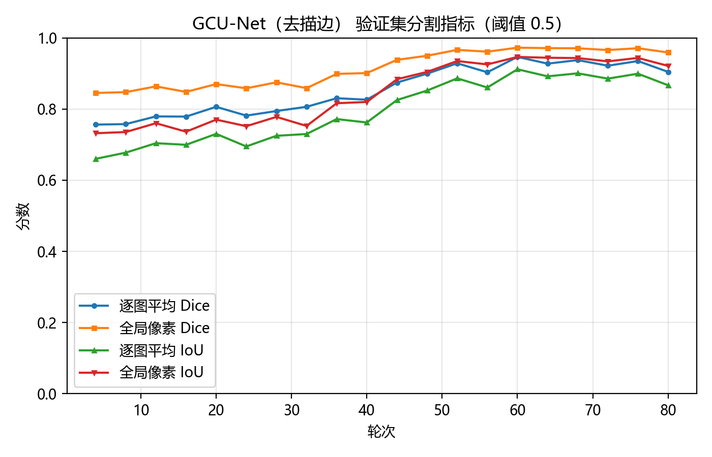
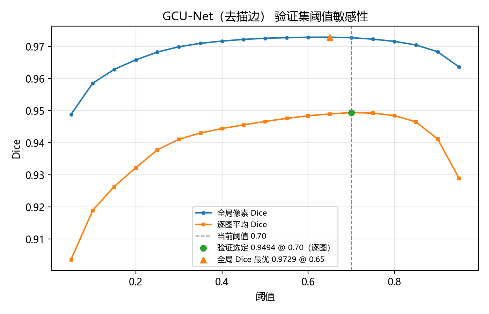

# GCU-Net

角膜荧光素染色图像的溃疡区域分割。仓库包含基线 FR-UNet 和数据适配模型 GCU-Net。GCU-Net 从零训练，6.938M 参数，输入为绿通道、绿度和角膜椭圆 ROI 三个通道。训练在单卡 RTX 4060 Laptop 8GB 上完成。

<p>
  
  
  
</p>

<p align="center">
  
</p>
<p align="center">
  <sub>图 1　去描边正式模型的验证集曲线（80 轮；训练时用 0.5 阈值监控，最终阈值 0.70 在验证集上按逐图平均 Dice 选定）。</sub>
</p>

## 一、结果

GCU-Net 在测试集（35 张）上的逐图平均 Dice 是 0.9332，IoU 0.8950；全测试集像素累计 Dice 0.9666，IoU 0.9354。AUC 0.9993，敏感度 0.9575，精确率 0.9246。35 张里只有 703 号低于 0.5（0.3482），没有低于 0.3 的样本。基线 FR-UNet 的测试逐图 Dice 是 0.7310，全局像素 Dice 0.8052。

| 模型 | 输入 | 参数量 | 验证逐图 Dice | 测试逐图 Dice | 测试全局 Dice |
| --- | --- | ---: | ---: | ---: | ---: |
| FR-UNet | 灰度，原图 | 7.374 M | 0.7309 | 0.7310 | 0.8052 |
| GCU-Net 第 1 轮 | 三通道，保留描边 | 6.938 M | 0.9882（第 24 轮） | 未测（泄漏参考） | - |
| GCU-Net 第 2 轮 | 三通道，去描边 | 6.938 M | 0.9494（0.70） | 0.9332 | 0.9666 |

第 2 轮测试的逐图 Dice 中位数 0.9735，标准差 0.1291，病灶面积与 Dice 的相关系数 r = 0.2559。加椭圆 gate 与不加 gate 的 Dice 几乎相同，个别图的差异小于 0.0001，gate 只去掉了极少量角膜外假阳。703 号是极细划痕，模型在上方泪膜和角膜缘产生假阳，真病灶漏检；684（0.599）和 698（0.694）是边界不规则的弥漫病灶，模型偏保守。

第一轮保留描边的 0.9882 是标签泄漏，不是模型能力，原因见第二节；这一轮没有在测试集上评估。

## 二、数据与白色描边

数据是 2592×1728 的角膜荧光素染色图，train 283 / val 36 / test 35。mask 中 `0` 为溃疡、`255` 为背景，读取时需要反相。训练、验证、测试的病灶面积占比分别是 2.70%、4.07%、6.73%，测试集病灶更大。划分按图片编号顺序切分，数据没有患者信息，患者级泄漏风险需要核实。

我在放大病灶区域后看到，溃疡外围有一圈人工画的白色多边形描边，mask 就是描边围出的区域。我用脚本统计了 354 张图，mask 边界全部落在近白像素的 3 像素范围内；用“近白阈值 + 闭运算 + 填洞”不需要任何模型就能复现 mask，验证集 Dice 均值 0.9708，测试集 0.9564。这说明图像里已经把答案画出来了。

第一版 GCU-Net 直接在这批图像上训练，第 20 轮验证 F1 是 0.9852，第 24 轮升到 0.9882，36 张验证图里有 30 张 Dice 大于 0.99。它学的是沿白线描边再填洞。我没有把这个结果当作分割能力，停止第一轮后，在输入前去掉近白描边：在角膜椭圆内检测近白像素，膨胀 2 像素后用 Telea 修复填平；红色标注环保留。去除后同一套“白线填洞”基线在抽查的 15 张验证图上从 0.971 降到 0.000，白色像素从平均 11854 个降到 7 个。

审计数字来自本地一次性只读脚本，脚本未随仓库保留；数据集不公开，无法在仓库内复算。训练和测试指标保存在本地 `saved/` 目录，未纳入 Git。

红环拟合的椭圆在 354 张图上全部成功，验证集和测试集的病灶像素分别有 99.90% 和 99.98% 落在椭圆内。椭圆面积平均占全图的 22% 到 26%，是角膜边界，不是围着病灶画的小圈。

## 三、方法

### 3.1 输入

三通道，尺寸 256×256：

1. `G/255`，用训练集统计量标准化（均值 0.3828，标准差 0.2403）；
2. `max(G - max(R,B), 0)/255`，绿度通道（均值 0.0528，标准差 0.1218）；
3. 角膜椭圆 ROI，内部 1、外部 0。

绿度通道把荧光素（绿）和红环（红）分开；ROI 通道给出“只看角膜”的先验，推理时再用膨胀 10 像素的椭圆 gate 压掉角膜外的预测。

### 3.2 结构

- 编码器：残差块，通道 32/64/128/256，最深 16×16；
- 瓶颈：ASPP，空洞率 3 和 6，加全局池化分支；
- 解码器：上采样 + 注意力门控 skip + 残差块；
- 深监督：1/2 和 1/4 分辨率两个辅助头，权重 0.4 和 0.2。

### 3.3 损失与采样

主损失为边界加权 BCE + Dice（各 0.5）。边界权重 `1 + 2·exp(-d/3)`，d 为到病灶边界的距离，按 patch 归一化到均值 1。正样本占 55%，70% 以随机病灶像素为中心裁剪，30% 在裁剪范围内随机取但要求至少含 4 个病灶像素；负样本只从病灶面积小于 5% 的图里取，要求 patch 内病灶像素为 0，4 张图都找不到空 patch 时退回最后一个候选；抽查的 400 个负样本均为空。

### 3.4 训练与推理

patch 256，batch 8，每轮 300 步，共 80 轮；Adam 1e-4，weight decay 1e-5，前 3 轮线性 warmup，之后余弦退火；AMP 混合精度，梯度裁剪 5.0；每 4 轮验证一次，按验证集逐图平均 F1（阈值 0.5）保存 best.pth（第 60 轮）。按训练日志，不含验证的轮约 46 到 71 秒，含验证的轮约 77 到 104 秒。

推理用 512×512 tile、stride 448，重叠区对 logit 取平均后 sigmoid，再乘椭圆 gate。阈值只在验证集上按逐图平均 Dice 选定（0.70）；测试集按 0.70 报告结果，另附事后阈值扫描仅作诊断，不参与选择。

<p align="center">
  
</p>
<p align="center">
  <sub>图 2　验证集阈值敏感性：绿点为按逐图平均 Dice 选定的 0.70，橙三角为全局像素 Dice 最优的 0.65；正式阈值取前者。</sub>
</p>

## 四、复现

本机解释器为 `B:\envs_dirs\IMIP\python.exe`，下面的 `python` 均指该环境。

```powershell
conda activate IMIP
python -m pip install torch==2.6.0 torchvision==0.21.0 `
  --index-url https://download.pytorch.org/whl/cu124
python -m pip install -r GCU-Net/requirements.txt

cd GCU-Net
python train.py -dp <data_root> -bs 8 --steps 300 --epochs 80
python test.py -dp <data_root>
```

断点续训：

```powershell
python train.py -dp <data_root> -bs 8 --steps 300 --epochs 80 --resume saved\GCU_Net_NoLine\last.pth
```

| 项 | 值 |
| --- | --- |
| Python | 3.10.22 |
| PyTorch / torchvision | 2.6.0+cu124 / 0.21.0+cu124 |
| numpy / opencv / scikit-learn | 1.26.4 / 4.10.0.84 / 1.5.2 |
| GPU | NVIDIA RTX 4060 Laptop 8GB（sm_89） |

数据目录结构（`-dp` 指向 `kuiyang` 这一层）：

```text
kuiyang/
├─ train/img/*.jpg
├─ train/mask/*.png
├─ val/img/*.jpg
├─ val/mask/*.png
├─ test/img/*.jpg
└─ test/mask/*.png
```

数据、权重与训练日志不随仓库分发。

## 五、目录

| 路径 | 内容 |
| --- | --- |
| `GCU-Net/` | 数据适配模型：训练、测试、数据管线、模型、指标 |
| `FR-UNet/` | 基线模型：训练、测试、数据读取、模型、指标 |
| `assets/` | README 预览图（验证集曲线与阈值敏感性，不含病例图像） |
| `GCU-Net/saved/` | 权重、日志、验证/测试指标（.gitignore 忽略，不随仓库分发） |
| `FR-UNet/saved/` | 基线权重与日志（同上） |

各目录的详细说明见 `GCU-Net/README.md` 与 `FR-UNet/README.md`。完整的第一人称实验报告在项目根目录的 `docs/实验报告/2/`（不随代码仓库分发）。

## 六、局限

1. 白色描边是数据集特有的标注痕迹。去描边后模型学到的是荧光区域本身，但 mask 仍是描边围出的区域，两者边界不完全一致，这是当前 Dice 的主要上限之一。
2. 椭圆 ROI 来自红色标注环，真实临床图像不一定有，不能直接外推。
3. 主指标在椭圆 gate 内统计；不加 gate 的全图 Dice 同时给出，跨方法比较时需要确认口径。
4. 划分按图片编号顺序切分，没有患者信息，患者级泄漏风险需要核实。
5. 绿度通道依赖荧光素染色和特定成像方式，换染色或光源后需要重新设计输入。
6. 去描边采用局部 Telea 修复，修复带和周围组织的纹理仍有差异。最终模型在去描边图像上训练，不能完全排除它利用修复带的位置信息；更严格的对照是只使用绿度/色度通道，或使用不含任何标注的原始图像重新采集数据。这一点在本轮没有做完整消融，属于后续工作。

## 七、许可与致谢

本仓库原创部分以 MIT 许可证发布，版权归 Yui-0818，全文见 [LICENSE](LICENSE)。FR-UNet 基线来自 [lseventeen/FR-UNet](https://github.com/lseventeen/FR-UNet)（MIT，Copyright (c) 2022 liuwentao），许可证见 [FR-UNet/LICENSE](FR-UNet/LICENSE)，第三方组件说明见 [NOTICE](NOTICE)。
